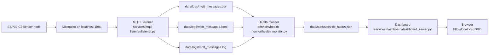

# Current Service Layout

This document records the post-migration Raspberry Pi service layout. It complements `docs/current-state-architecture.md`, which remains the pre-migration architecture baseline.

## Source of Truth

For new chat takeover, read `docs/chat-handoff.md` first, then use this document for the current service layout. Future platform finalization work is tracked in `TODO.md`.

The current service-owned Python entrypoints are:

| Component | Current path | Runtime model |
| --- | --- | --- |
| MQTT listener | `services/mqtt-listener/listener.py` | Continuous systemd service |
| Health monitor | `services/health-monitor/health_monitor.py` | Timer-triggered oneshot service |
| Health/status helper | `services/health-monitor/device_status.py` | Imported by health monitor; optional CLI |
| Dashboard | `services/dashboard/dashboard_server.py` | Continuous systemd service |

Legacy root-level files are retained only as compatibility wrappers during the migration period:

```text
mqtt_listener/listener.py -> services/mqtt-listener/listener.py
health_monitor.py         -> services/health-monitor/health_monitor.py
device_status.py          -> services/health-monitor/device_status.py
dashboard_server.py       -> services/dashboard/dashboard_server.py
```

## Runtime Paths

Runtime data now lives under repository-root `data/`:

```text
data/logs/mqtt_messages.log
data/logs/mqtt_messages.jsonl
data/logs/mqtt_messages.csv
data/status/device_status.json
```

The systemd units keep:

```ini
WorkingDirectory=/home/zack/projects/raspberry-pi
```

The legacy root-level `logs/` directory may still exist as historical runtime data during migration, but current services read and write `data/`.

## Configuration

Shared defaults live in:

```text
config/platform.py
```

This module centralizes:

- MQTT broker host, port, and topic filter
- Runtime data paths
- MQTT CSV columns
- Device report columns
- Online threshold
- Dashboard host and port

The services still expose their previous local constant names as aliases for compatibility, but those values now come from `config/platform.py`.

## systemd Units

Repository-owned reference units:

```text
systemd/mqtt-listener.service
systemd/health-monitor.service
systemd/health-monitor.timer
systemd/iot-dashboard.service
```

Expected live service names:

| Unit | Purpose | Expected script |
| --- | --- | --- |
| `mqtt-listener.service` | Subscribe to `home/#` and write MQTT logs | `services/mqtt-listener/listener.py` |
| `health-monitor.service` | Build latest device status JSON | `services/health-monitor/health_monitor.py` |
| `health-monitor.timer` | Run the health monitor every minute | `health-monitor.service` |
| `iot-dashboard.service` | Serve the local dashboard on port 8080 | `services/dashboard/dashboard_server.py` |

No database, MQTT authentication, or device registry has been added yet.

## Device Onboarding Status

The platform can accept additional MQTT devices now if they follow the current onboarding contract in `docs/device-onboarding.md`.

Recommended topic shape:

```text
home/devices/<device-id>/<message-type>
```

The listener still subscribes to `home/#`. Canonical `home/devices/<device-id>/<message-type>` topics are parsed and validated against the JSON `device`; invalid records stay in raw JSONL but do not update device state. Legacy topics remain supported.

The dashboard summary now shows combined health, heartbeat freshness, and retained availability. Detail panels show latest status, telemetry, and availability fields. The health monitor writes a derived snapshot under `data/status/` without changing archived MQTT events. Declared sleepy devices use a three-interval freshness window.

The dashboard also reads a fixed set of local systemd units for a read-only Services table: `mosquitto.service`, `mqtt-listener.service`, `health-monitor.timer`, `health-monitor.service`, and `iot-dashboard.service`. Its systemctl call is bounded by a two-second timeout. The one-shot health monitor is shown by its last run result, not marked down merely for being inactive between timer runs. Restart actions are deferred until narrow systemd permissions are in place.

The `birdfeeder-01` detail row also exposes its four MQTT commands and temporary MJPEG stream URL. The dashboard service publishes commands and waits for a response; the listener still only archives command/response traffic. Command buttons are disabled on the ordinary LAN page. Actions require a loopback connection, typically through an authenticated SSH tunnel to the Pi, plus a local Host, matching Origin, and dashboard action header.

The `front-porch-camera-01` detail row exposes `start_stream`, `stop_stream`, `stream_info`, and `status_now`, plus its port-80 MJPEG URL and active stream link. The same dashboard command path waits for the camera's response fields and has the same SSH-tunnel action restriction. The LAN dashboard remains readable.

## Data Flow



## Verification

Check the running services:

```bash
systemctl status mqtt-listener.service --no-pager
systemctl status health-monitor.timer --no-pager
systemctl status health-monitor.service --no-pager
systemctl status iot-dashboard.service --no-pager
```

Check the active paths:

```bash
systemctl show mqtt-listener.service \
  -p ExecStart -p WorkingDirectory --no-pager
systemctl show health-monitor.service \
  -p ExecStart -p WorkingDirectory --no-pager
systemctl show iot-dashboard.service \
  -p ExecStart -p WorkingDirectory --no-pager
```

Check recent logs:

```bash
journalctl -u mqtt-listener.service -n 50 --no-pager
journalctl -u health-monitor.service -n 50 --no-pager
journalctl -u iot-dashboard.service -n 50 --no-pager
```

Check runtime files:

```bash
ls -l data/logs/mqtt_messages.log
ls -l data/logs/mqtt_messages.jsonl
ls -l data/logs/mqtt_messages.csv
ls -l data/status/device_status.json
```

## Rollback Notes

Each migration stage has its own rollback note:

```text
docs/mqtt-listener-migration.md
docs/health-monitor-migration.md
docs/dashboard-migration.md
docs/device-status-migration.md
```

Prefer using those stage-specific rollback steps. The broad rollback pattern is to point the affected systemd unit back to the previous root-level script, run `sudo systemctl daemon-reload` if the unit file changed, then restart the affected service.

Do not delete legacy root-level wrappers until the service layout has been stable through normal reboots and timer runs, and any manual habits or external references have been updated to the `services/` paths.
